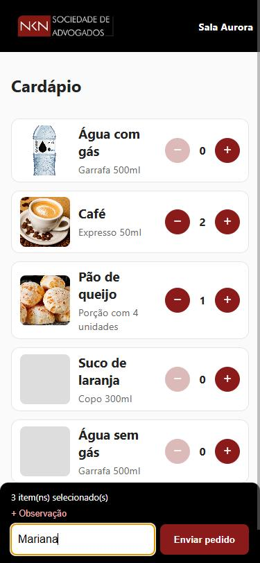
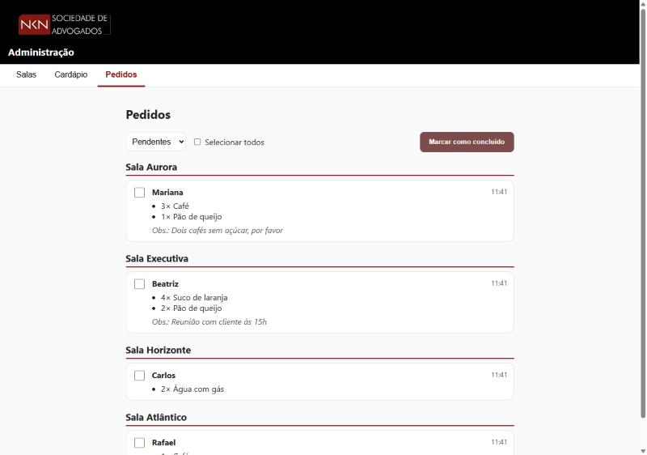
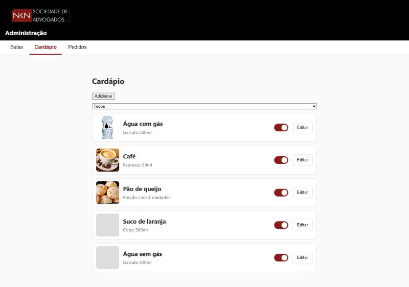
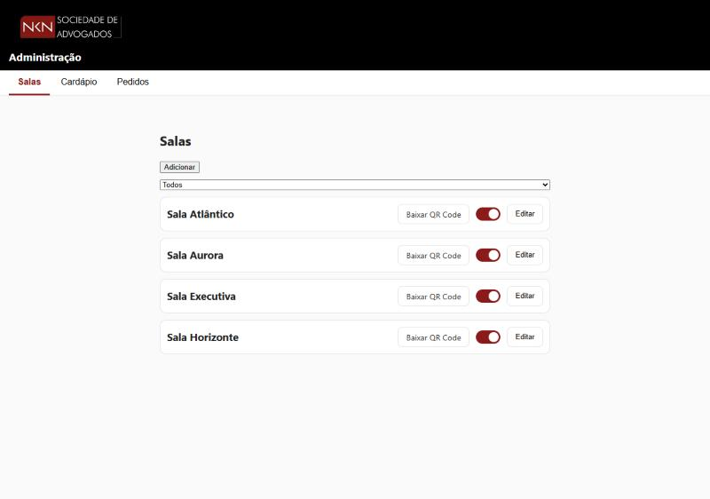

# Sistema de Pedidos de Copa


Sistema web para pedir **bebidas e lanches nas salas de reunião** por **QR Code**, com aviso automático no WhatsApp da copa e um painel de administração.

Desenvolvido para a **NKN Sociedade de Advogados**. Os dados das capturas de tela abaixo são fictícios.

<p align="center">
  
  &nbsp;&nbsp;
  
</p>

## O problema

Nas reuniões com clientes, a copa preparava um prato de pão de queijo e bebidas para cada participante, e muitos não queriam. Perguntar a cada um, no meio da reunião, era inconveniente.

## A solução

Cada sala tem um **QR Code fixo**. O participante lê o código com o celular, informa o nome, escolhe o que deseja (e deixa uma observação, como "sem açúcar") e envia. O pedido chega **direto no grupo de WhatsApp da copa**, já identificado pela sala, e também aparece no painel de administração. Sem login para o cliente e sem cobrança.

## Funcionalidades

**Cliente (mobile-first)**
- Entrada pelo QR Code da sala (`/?room=<id>`), com validação da sala
- Cardápio com fotos, descrição e controle de quantidade
- Campo de observação e resumo fixo do pedido
- Confirmação do envio e tratamento de erros (QR inválido, falha de rede)

**Administração (protegida por senha)**
- **Pedidos:** agrupados por sala, filtro por status, seleção em lote para marcar como concluído, atualização automática
- **Cardápio:** cadastro e edição de alimentos, upload de foto, ativar e desativar com um clique
- **Salas:** cadastro, ativar e desativar, **download do QR Code** de cada sala

**Integrações**
- Aviso de cada novo pedido em um grupo de WhatsApp (Z-API). Uma falha no envio **nunca impede o pedido**.

## Capturas de tela

| Cardápio (admin) | Salas e QR Codes (admin) |
|---|---|
|  |  |

## Tecnologias

| Camada | Tecnologias |
|---|---|
| Front-end | React 19, TypeScript, Vite |
| Back-end | Node.js 24, Express 5, TypeScript |
| Banco de dados | MySQL 8 (`mysql2`, consultas parametrizadas, transações) |
| Validação | Zod (esquemas compartilhados entre front e back) |
| Outros | Multer (upload), qrcode (geração dos QR Codes) |
| Testes | Jest, Supertest (testes de integração com banco real) |
| Infraestrutura | Docker (multi-stage), Docker Compose |
| CI/CD | GitHub Actions, GitHub Container Registry (GHCR) |

## Como rodar (1 minuto, só com Docker)

**Requisitos:** Docker e Git. Não precisa instalar Node nem MySQL.

```bash
git clone https://github.com/felipebagarelli/SitePedidosReuniao.git
cd SitePedidosReuniao
docker compose up --build app
```

O Compose sobe o MySQL (já com as tabelas criadas) e a aplicação.

1. Abra `http://localhost:3000/admin` e entre com o usuário `admin` e a senha `admin_dev` (valores **apenas de desenvolvimento**, definidos no `docker-compose.yml`).
2. Cadastre uma sala e alguns alimentos.
3. Abra `http://localhost:3000/?room=<id da sala>` para ver a tela do cliente.

Para parar e manter os dados: `Ctrl+C`. Para apagar também o banco: `docker compose down -v`.

## Testes

```bash
docker compose run --rm test
```

Os testes rodam **dentro do container**, no mesmo ambiente da imagem de produção (mesma versão do Node, dependências instaladas com `npm ci`), contra um banco `pedidos_test` separado. Há uma trava que impede executá-los em qualquer banco cujo nome não termine em `_test`.

## CI/CD

A cada push e pull request, o GitHub Actions executa:

```
 verificação de tipos (tsc)
          ↓
 testes dentro do container
          ↓
 build da imagem de produção
          ↓                         (somente push na main, e só se tudo acima passou)
 publicação da imagem no GHCR
```

- **CI:** os mesmos comandos do desenvolvimento local rodam no pipeline, então "funciona na minha máquina" e "funciona no CI" significam a mesma coisa.
- **Entrega contínua (Continuous Delivery):** a imagem só é publicada se os testes passarem (`needs: test`). A imagem publicada é exatamente a que foi testada, e fica pronta para ser executada em qualquer servidor.
- **Sem segredos no repositório:** o login no registry usa o `GITHUB_TOKEN` temporário que o próprio GitHub gera a cada execução.

A imagem pode ser baixada com:

```bash
docker pull ghcr.io/felipebagarelli/sitepedidosreuniao:latest
```

Ela contém apenas a aplicação; o banco e as variáveis de ambiente são fornecidos de fora, como no `docker-compose.yml`. As imagens também recebem uma tag com o commit (`sha-...`), o que permite saber exatamente qual código está em cada versão.

## Decisões técnicas

- **Dockerfile multi-stage:** um estágio instala as dependências, outro faz o build, outro roda os testes e o último (produção) leva só o resultado. A imagem final não tem `node_modules` nem código-fonte, porque o servidor é empacotado em um único arquivo com esbuild. Roda com um usuário sem privilégios (`USER node`).
- **Uma versão de Node só:** a mesma imagem base é usada nos testes e em produção. Isso elimina a diferença de versão entre máquina de desenvolvimento e servidor.
- **Arquitetura em camadas:** rota → controller → service → repository, com tratamento centralizado de erros (classes de erro com código HTTP).
- **Integridade dos dados:** pedido e itens gravados em **transação**; índice único no nome dos alimentos; alimentos e salas são **desativados, nunca apagados**, preservando o histórico.
- **Segurança:** autenticação básica com comparação em tempo constante, validação de toda entrada, SQL parametrizado, upload restrito por tipo e tamanho com nome gerado no servidor, e nenhum segredo no repositório (tudo em variáveis de ambiente).
- **Testes:** mais de 90 testes automatizados (repositories e rotas), com banco real e trava de segurança.
- **Resiliência:** o envio ao WhatsApp é isolado do fluxo principal, com tempo limite e registro de falhas.

## Desenvolvimento sem Docker

**Requisitos:** Node.js 24 e MySQL.

```bash
npm install

# banco: crie e importe o esquema
mysql -u root -p -e "CREATE DATABASE pedidos CHARACTER SET utf8mb4"
mysql -u root -p pedidos < database/schema.sql

cp .env.example .env     # preencha os valores

npm run dev              # servidor (porta 3000)
npm run dev:web          # front-end (porta 5173), em outro terminal
```

### Variáveis de ambiente

| Variável | Descrição |
|---|---|
| `DB_HOST`, `DB_USER`, `DB_PASSWORD`, `DB_NAME` | Conexão com o MySQL |
| `PUBLIC_URL` | Endereço público do sistema (vai dentro dos QR Codes) |
| `ADMIN_USER`, `ADMIN_PASSWORD` | Credenciais do painel de administração |
| `ADMIN_AUTH_DISABLED` | Somente desenvolvimento: libera o painel sem senha |
| `ZAPI_*` | Credenciais da Z-API (opcional: sem elas, o aviso é ignorado) |

## Estrutura

```
src/
  server/    API: auth, food, rooms, orders, uploads, whatsapp
  shared/    esquemas e tipos compartilhados (Zod)
  web/       front-end: client/ (cliente) e admin/ (painel)
tests/       configuração dos testes
database/    schema.sql
docker/      script de inicialização do banco
Dockerfile
docker-compose.yml
.github/workflows/ci.yml
```

## API (resumo)

| Rota | Acesso |
|---|---|
| `GET /api/rooms/:id`, `GET /api/foods?active=true`, `POST /api/orders` | público (usadas pelo cliente) |
| Demais rotas de `/api/foods`, `/api/rooms`, `/api/orders` e `POST /api/uploads` | administração (senha) |

## Autor

**Felipe Bagarelli**
[LinkedIn](https://www.linkedin.com/in/felipebagarelli) · [GitHub](https://github.com/felipebagarelli)

## Licença

Todos os direitos reservados. O código está disponível para consulta como portfólio.